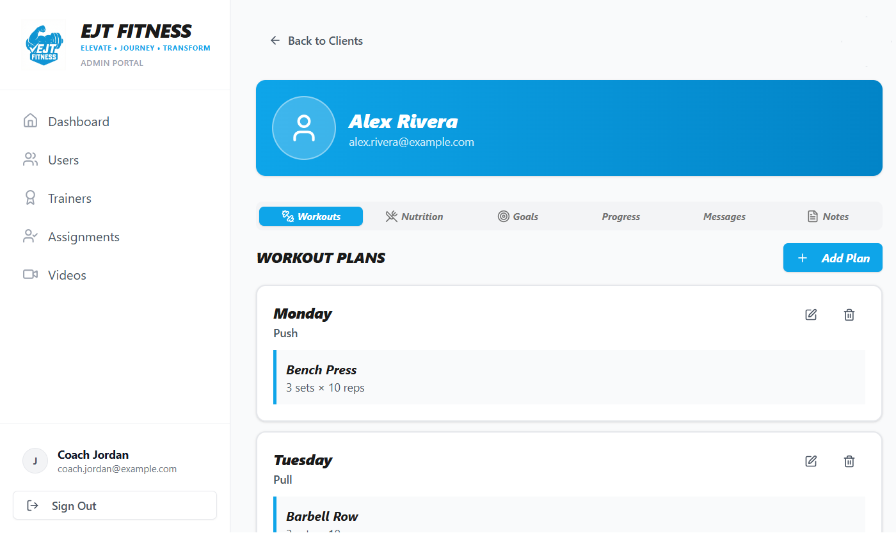
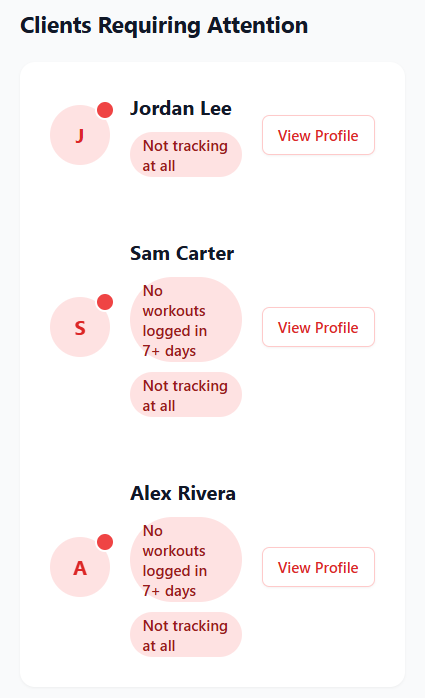
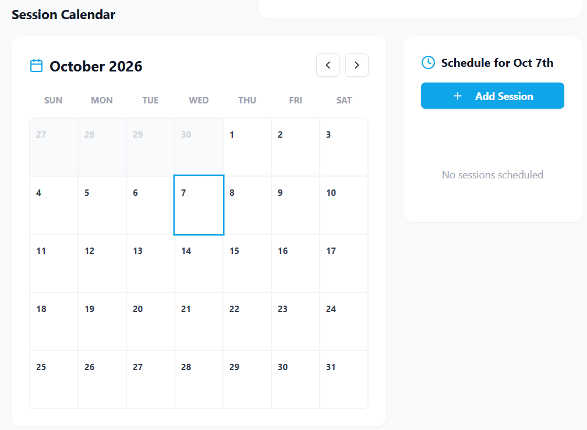
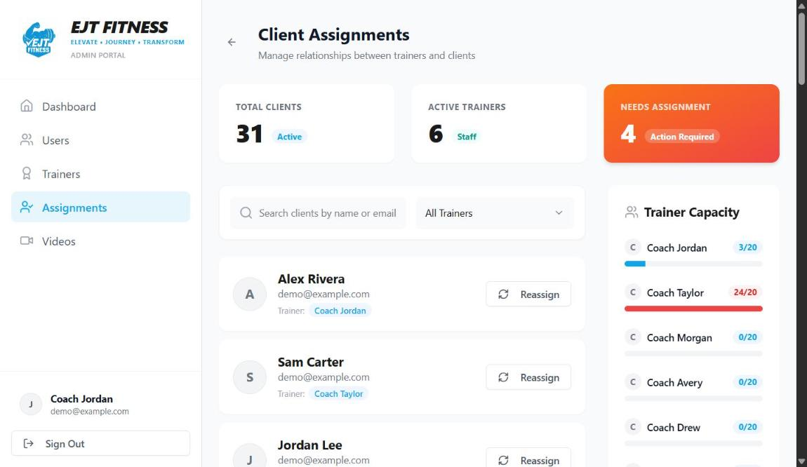
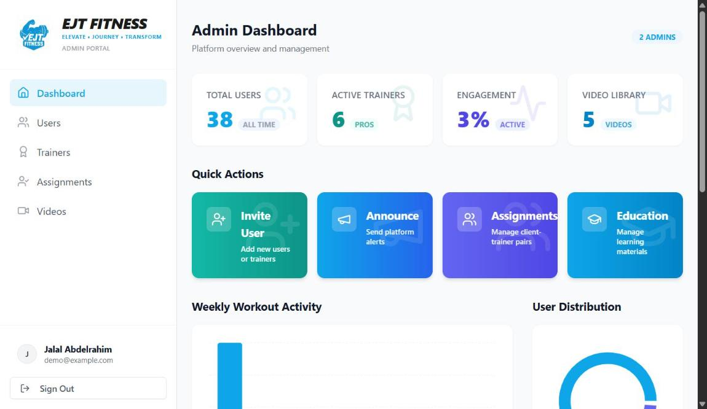
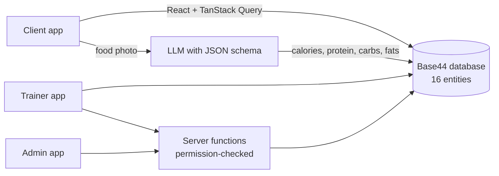

# EJT Fitness: Case Study

**How I built EJT Fitness a platform for managing its trainers and clients, and for making asynchronous coaching feel personal.**

> This is client work, so the source code is private. This page covers the problem, what I built and the engineering decisions behind it. Screenshots use placeholder data.

| | |
|---|---|
| **Client** | EJT Fitness, a personal-training agency |
| **My role** | Sole developer: product, design and build, plus ongoing support |
| **Users** | EJT's trainer team and 30+ active clients |
| **Built with** | React, Tailwind, shadcn/ui, TanStack Query, Recharts, on Base44 (auth, database, hosting, serverless functions, LLM) |

---

## The problem

Most of EJT's coaching happens **asynchronously**. Clients train on their own schedule, at home or at the gym, and see their trainer in person only now and then. Between sessions, coaching ran through texts, spreadsheets and photos sent over chat:

- Workout plans were sent as messages and got buried in the thread.
- Clients reported meals in screenshots, if they reported them at all.
- Trainers had no single view of a client's week, so they couldn't tell who was on track and who had gone quiet until it was too late.
- With several trainers and a growing client list, the owner had no easy way to see which client belonged to which trainer, or to reassign them.

As a result, the coaching felt generic. Trainers spent their time chasing updates instead of adjusting each client's plan, and clients felt like they were on their own between sessions.

**The goal:** a single platform where EJT could manage its trainers and clients, and where coaching would feel **personal even when the trainer isn't in the room**:
- **Clients** open the app and see *their* plan for today, written by *their* trainer. They log food in seconds and watch their own progress.
- **Trainers** see everything each client does between sessions, so they can adjust plans, nutrition targets and check-ins for that person.
- **The owner** manages the trainer team, assigns clients to trainers and messages everyone from one place.

EJT is a small team with no engineers, so it also had to run without anyone maintaining servers.

## What I built

Each role gets its own app experience.

### Clients
- **Today's workout** from their trainer's plan, with an exercise checklist, sets and reps, and form videos
- **AI food logging**: take a photo, upload an image or scan a barcode, and get calories and macros back
- **Progress tracking**: weight, body composition, lifts and progress photos, shown in charts
- **Next session**, plus direct messaging with their trainer

### Trainers

- **Client roster with a compliance score**, a weighted mix of workout completion, nutrition adherence and logging consistency, so trainers can see who needs a check-in
- **Per-client workspace** with tabs for workouts, nutrition plans, goals, progress, notes and messages
- **Session calendar**: a month grid for creating, editing and deleting 1-on-1 sessions

<table>
<tr>
<td width="35%"></td>
<td width="65%"></td>
</tr>
<tr>
<td>Flags clients who've gone quiet between sessions</td>
<td>Session calendar</td>
</tr>
</table>

### Admin

- Analytics across the whole platform
- Inviting users and assigning clients to trainers
- Announcements targeted at all users, trainers only or clients only, plus educational content and videos

## How it works

- **16 data entities** in four groups: people (users, trainer assignments), training (plans, logs, sessions, videos, notes), nutrition (plans, calorie logs, daily status) and progress (metrics, photos, goals). There's also messaging and announcements.
- **9 server functions** handle anything that touches another user's records, like assigning clients, inviting users, sending announcements and changing calorie goals. Every one checks the caller's permissions first. Trainers can only claim clients for themselves, and only admins can move clients between trainers.
- **Typed AI output.** Every food-analysis call to the LLM includes a JSON schema, so the result is structured nutrition data that goes straight into the database, with no free text to parse.
- **One camera button.** A captured frame is checked for a barcode first. If there isn't one, it's analyzed as a food photo, so users never have to pick a mode.

### Why Base44
A small training agency doesn't need, and can't pay for, someone to look after servers. Base44 provided production authentication, a database, hosting and serverless functions on day one, so the time went into features. The trade-off was less control over built-in parts like user roles, which caused the second problem below.

## Problems I solved

### 1. Food logged at night showed up on the next day
Clients said their food log "reset at 7 PM". The app worked out "today" in UTC, and 7 PM in Toronto is midnight UTC, so evening meals were saved under tomorrow's date. The same mistake was in four places: the photo analyzer, the calorie tracker, the analytics charts and the session calendar. In the calendar, a 10 AM session was saved as 15:00 UTC and showed at the wrong time.

**Fix:** dates are now saved as plain local date strings (`2026-04-07`) and compared as strings, never converted back to dates. Session times keep the trainer's local time with no UTC conversion. I gave clients a test to run (log a meal after 8 PM and check it stays on today) to confirm the fix.

### 2. Logs "disappeared" after about 10 days
Clients' 30-day nutrition charts had gaps. The data was fine: queries were using the database's default limit of 50 records and sorting by creation time. A client logging 5 items a day lost everything older than about 10 days.

**Fix:** explicit query limits sized for 30-day windows, sorted by log date instead of creation time.

### 3. Trainers and clients couldn't see each other
The trainer–client link was stored in two places: an assignment table, and a field on each user for quick "who's my trainer" lookups. When the two disagreed, clients couldn't see their trainer and trainers saw the wrong roster.

**Fix:**
- Reassignments now update both places in a single server function.
- Admin-only jobs repaired the existing records.
- An internal **diagnostic page** looks up a client, compares the two records, reports any mismatch and fixes it with one click.

### 4. Trainers weren't recognized as trainers
The platform's built-in role field couldn't reliably tell trainers apart from clients, so trainer screens and permissions broke. **Fix:** I added a separate user-type field, and permission checks accept either one.

### 5. "My workout plan is gone"
A client said their plans had disappeared. Digging into the data showed they had signed up a second time with a different email. The plans were safely on the original account. **Fix:** a support issue rather than a code bug. Logging in with the original account solved it, and it's now on the list to detect duplicate sign-ups at registration.

## Results
- **One place for the whole agency.** EJT manages its trainers, 30+ clients and every trainer–client assignment in the platform instead of in texts and spreadsheets.
- **Personal coaching between sessions.** Each client gets their own trainer-written workout and nutrition plan, and the trainer sees their logs, progress and messages, so plans get adjusted for that person rather than staying one-size-fits-all.
- **Trainers check in where it matters.** The compliance score shows who's slipping, so trainers reach out to those clients first instead of chasing everyone.
- **Logging is easy enough that clients actually do it.** Food logging takes one tap, with a photo or barcode, so trainers have real data to coach from.

## What's next
- **A unified fitness calendar** showing workouts, nutrition check-ins, weigh-ins and sessions on one timeline, so a trainer can see at a glance whether a client hit their workout, nutrition and weigh-in on a given day.
- Marking sessions complete, which would log the workout automatically.
- Detecting duplicate accounts at sign-up.

---

Built by **Jalal Abdelrahim** · [GitHub](https://github.com/richsudaniman)
